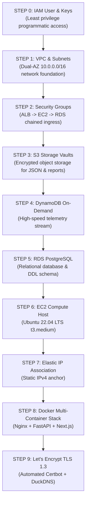

# CloudTwin — Master Architecture, Cloud Engineering & Project Defense Guide
**Subject:** Advanced Cloud Architecture & Cloud Development  
**Platform:** CloudTwin — AI-Powered Digital Twin & What-If Simulation Platform for AWS Cloud Architectures  
**Target AWS Region:** `ap-south-1` (Asia Pacific — Mumbai)  
**Authors / 6-Member Engineering Team Division:** 
- **Member 1: Santanu (Team Lead & Cloud System Architect):** Full-Stack Digital Twin Platform (Next.js 14 App Router, React Flow Canvas), FastAPI Orchestration Core, Canonical Architecture Schema, API Gateway & State Management
- **Member 2 (Simulation & Failure Injection Modeling Engineer):** Digital Twin Behavioral Simulation Engine, Monte Carlo Failure Injection, 10× Traffic Surge Modeling, Multi-AZ Outage Scenarios, Latency & Queue Dynamics
- **Member 3 (Cloud FinOps & Cost Intelligence Engineer):** AWS Cost Intelligence & Pricing Engine ($ and ₹), Service-Level Projections, Baseline vs. Simulated Cost Deltas, AWS Pricing Calculator Alignment
- **Member 4 (Cloud Security & Compliance Engineer):** CIS AWS Foundations Benchmark v1.4.0 Scanner, Security Hub Rule Mapping, Zero-Trust Network Auditing, IAM Least-Privilege & Port Exposure Risk Scoring
- **Member 5 (AI Cloud Architect & Generative Topology Engineer):** Gemini AI / LLM Architecture Advisor, Automated Topology Diff Generator (`suggested_topology_diff`), Failure Root-Cause Diagnosis & Well-Architected Recommendations
- **Member 6 (Cloud Infrastructure, DevOps & SRE Lead):** AWS VPC (Dual-AZ), Security Group Chaining, Polyglot Data Layer (AWS RDS PostgreSQL + DynamoDB On-Demand + S3 Vaults), Docker Multi-Container Stack, Nginx TLS 1.3 Reverse Proxy & Let's Encrypt Automation, Zero-Cost Teardown Governance

---

## Table of Contents
1. [Executive Summary & Purpose: Why CloudTwin Was Created](#1-executive-summary--purpose-why-cloudtwin-was-created)
2. [How CloudTwin Works: Mechanisms & Core Architecture](#2-how-cloudtwin-works-mechanisms--core-architecture)
3. [Deep-Dive: Why Referencing Security Group IDs in Inbound Rules is Critical](#3-deep-dive-why-referencing-security-group-ids-in-inbound-rules-is-critical)
4. [Master AWS Services Inventory: What Is Used & Why](#4-master-aws-services-inventory-what-is-used--why)
5. [End-to-End Step-by-Step Deployment Analysis](#5-end-to-end-step-by-step-deployment-analysis)
6. [Real-World Engineering Obstacles & Battle-Tested Fixes](#6-real-world-engineering-obstacles--battle-tested-fixes)
7. [Alignment with AWS Well-Architected Framework (6 Pillars)](#7-alignment-with-aws-well-architected-framework-6-pillars)
8. [Teardown, Cost Governance & Zero-Billing Protocol](#8-teardown-cost-governance--zero-billing-protocol)
9. [Team Presentation & Viva Defense Cheat Sheet](#9-team-presentation--viva-defense-cheat-sheet)

---

## 1. Executive Summary & Purpose: Why CloudTwin Was Created

### The Real-World Industry Problem
In traditional cloud development, testing AWS architectures has severe flaws:
1. **Testing in Production is Catastrophic:** Outages, network partitioning, and traffic spikes are usually discovered *after* users experience downtime.
2. **Staging Environments are Prohibitively Expensive:** Replicating multi-AZ RDS clusters, ALBs, NAT Gateways, and ECS fleets just to run stress tests costs thousands of dollars per month.
3. **Architecture Drift & Blind Spots:** Infrastructure as Code (Terraform, CloudFormation) defines syntax, but cannot dynamically predict **cost surges**, **bottlenecks under 10× traffic**, or **CIS security violations** before deployment.

### The CloudTwin Solution: What Is It?
**CloudTwin is an AI-powered Digital Twin platform for AWS Cloud Architectures.**
Just as aerospace engineers test aircraft in a virtual wind tunnel before building physical wings, CloudTwin allows cloud engineers to:
- **Visually construct AWS architectures** across 11 native AWS services.
- **Run non-destructive What-If simulations** (e.g., 10× traffic surges, primary AZ outages, database node crashes).
- **Inspect live performance telemetry, queue latencies, and service bottlenecks.**
- **Calculate dynamic cost impacts down to the service level** (in both USD `$` and INR `₹`).
- **Audit topology against CIS AWS Foundations Benchmark v1.4.0.**
- **Receive AI-generated topology recommendations with visual before/after diffs.**

---

## 2. How CloudTwin Works: Mechanisms & Core Architecture

### 2.1 The Digital Twin Concept
A **Digital Twin** is a software representation of a physical or distributed cloud system that mirrors its real-world state, behaviors, and resource limitations. In CloudTwin, every AWS service node is not just an icon; it is an active mathematical and behavioral model.

```
+---------------------------------------------------------------------------------------+
|                                CLIENT TIER (Browser)                                  |
|   Next.js 14 App Router | React Flow Interactive Canvas | Recharts | Framer Motion    |
|   - 1.5s Debounced Auto-Save                                                          |
|   - LocalStorage Session & Hash-Based Routing (#simulator, #cost, #security)          |
+-------------------------------------------┬-------------------------------------------+
                                            │ HTTPS / REST (Port 443 via TLS 1.3)
                                            ▼
+---------------------------------------------------------------------------------------+
|                       REVERSE PROXY & GATEWAY TIER (AWS EC2)                          |
|   Nginx 1.25+ Alpine Container with Let's Encrypt TLS Certificates                    |
|   - Port 80 -> 301 Permanent Redirect to HTTPS (Port 443)                             |
|   - ACME Challenge Handler for SSL Renewal                                            |
|   - Proxy Timeouts tuned to 300s (Prevents 502 Bad Gateway during heavy simulations)   |
|   - Path Routing: `/api/*` & `/docs` -> Backend (8000) | `/*` -> Frontend (3000)       |
+---------------------+-------------------------------------------+---------------------+
                      │                                           │
                      ▼                                           ▼
+---------------------------------------+   +-------------------------------------------+
|          FRONTEND CONTAINER           |   |       BACKEND ORCHESTRATION CONTAINER     |
|   Node.js 20 (Port 3000 Internal)     |   |   FastAPI + Uvicorn (Port 8000 Internal)  |
|   Server-Side Rendering + Client App  |   |   System Integration & Orchestration      |
+---------------------------------------+   +---------------------+---------------------+
                                                                  │
                    ┌─────────────────────────────────────────────┼─────────────────────────┐
                    │                                             │                         │
                    ▼                                             ▼                         ▼
    +-------------------------------+             +-------------------------------+   +-----------------------------+
    | SIMULATION ENGINE (Member 2)  |             | COST ENGINE (Member 3)        |   | DEVOPS & INFRA (Member 6)   |
    | - Traffic Surge (10x)         |             | - AWS Pricing API Engine      |   | - Dual-AZ VPC & Subnets     |
    | - Multi-AZ Outage Injection   |             | - Baseline vs Simulated Deltas|   | - SG Chaining & Docker Stack|
    | - Latency & Queue Dynamics    |             | - Currency Conversion ($ & ₹) |   | - Let's Encrypt TLS 1.3     |
    +---------------+---------------+             +---------------+---------------+   +--------------+--------------+
                    │                                             │                                  │
                    ├─────────────────────────────────────────────┼──────────────────────────────────┘
                    ▼                                             ▼
    +-------------------------------+             +-------------------------------+
    | SECURITY SCANNER (Member 4)   |             | AI ADVISOR ENGINE (Member 5)  |
    | - CIS Foundations v1.4.0      |             | - Google Gemini AI / LLM      |
    | - Security Hub Rule Mapping   |             | - Suggested Topology Diffs    |
    | - Zero-Trust Boundary Audit   |             | - Failure Remediation Plans   |
    +---------------+---------------+             +---------------+---------------+
                    │                                             │
                    └───────────────────────┬─────────────────────┘
                                            ▼
+---------------------------------------------------------------------------------------------------------------+
|                        AWS CLOUD DATA LAYER (Provisioned & Maintained by Member 6 & Member 1)                 |
|                                                                                                               |
|   +───────────────────────────────+   +───────────────────────────────+   +───────────────────────────────+   |
|   |      AWS RDS PostgreSQL       |   |       Amazon DynamoDB         |   |          Amazon S3            |   |
|   |         (Port 5432)           |   |    (On-Demand NoSQL Store)    |   |            Vaults             |   |
|   |  - Projects & Users           |   |  - Simulation Events Stream   |   |  - Topologies & JSON Diffs    |   |
|   |  - Canonical Architecture JSON|   |  - Real-time Telemetry Logs   |   |  - PDF Reports & Audit Files  |   |
|   |  - Version History & Audits   |   |  - High-velocity time series  |   |  - SSE-S3 Encrypted Storage   |   |
|   +───────────────────────────────+   +───────────────────────────────+   +───────────────────────────────+   |
+---------------------------------------------------------------------------------------------------------------+
```

### 2.2 6-Member Ownership & Responsibilities Matrix

| Member | Engineering Role | Core Module Ownership | Key Deliverables & Technologies |
| :--- | :--- | :--- | :--- |
| **Member 1: Santanu** *(Lead)* | **Team Lead & Cloud System Architect** | **Full-Stack Digital Twin Platform & Core Orchestration** | Next.js 14 App Router, React Flow Canvas (`@xyflow/react`), FastAPI Core, Canonical Schema Contract, LocalStorage & URL Hash State Persistence, API Gateway & Cross-Engine Bridge. |
| **Member 2** | **Simulation & Failure Injection Modeling Engineer** | **Digital Twin Behavioral Simulation Engine** | Mathematical behavioral modeling, Monte Carlo failure simulation, 10× traffic surge modeling, Multi-AZ blackout scenarios, latency/queue depth calculations, service bottleneck detection. |
| **Member 3** | **Cloud FinOps & Cost Intelligence Engineer** | **AWS Cost Intelligence & Pricing Engine** | Dynamic AWS Pricing API integration ($ and ₹), service-level cost projections, baseline vs. simulated cost differential calculation, AWS Pricing Calculator alignment. |
| **Member 4** | **Cloud Security & Compliance Engineer** | **Security Posture & CIS Benchmark Scanner** | CIS AWS Foundations Benchmark v1.4.0 scanner, AWS Security Hub integration, zero-trust network boundary evaluation, Security Group rule audit, vulnerability risk scoring. |
| **Member 5** | **AI Cloud Architect & Generative Topology Engineer** | **Generative AI Architecture Recommendation Advisor** | Google Gemini AI / LLM integration, automated architecture topology diff generator (`suggested_topology_diff`), root cause failure mitigation, Well-Architected recommendation engine. |
| **Member 6** | **Cloud Infrastructure, DevOps & SRE Lead** | **Cloud Infrastructure, DevOps, Polyglot Database & Deployment** | Dual-AZ AWS VPC & Security Group chaining, AWS RDS PostgreSQL schema migration, Amazon DynamoDB event streams, S3 Vaults, Docker multi-container stack, Nginx TLS 1.3 & automated SSL/DuckDNS provisioning, zero-cost teardown governance. |

### 2.3 Canonical Architecture Graph Mechanism
CloudTwin represents cloud topologies using a normalized JSON schema:
- **Nodes (`nodes[]`):** Each node represents an AWS service with properties:
  - `id`: Unique identifier (e.g., `ec2-cluster-1`).
  - `type`: One of the 11 supported AWS node types (`ec2`, `s3`, `rds`, `lambda`, `api_gateway`, `cloudfront`, `alb`, `vpc`, `nat_gateway`, `dynamodb`, `ecs`).
  - `data`: Service-specific parameters (instance type `t3.medium`, Multi-AZ flag, volume size, IOPS, provisioned capacity).
- **Connections (`connections[]`):** Directed network and logical edges defining flow (e.g., `alb -> ec2 -> rds`).
- **Simulation Pipeline:**
  1. **Member 1 (Frontend):** Compiles canvas graph into canonical JSON schema with 1.5s debounced auto-save.
  2. **Member 1 (FastAPI Core):** Validates schema with Pydantic v2 and orchestrates parallel execution.
  3. **Member 2 (Simulation):** Computes latency, error rates, queue depths, and bottleneck flags under failure scenarios.
  4. **Member 3 (Cost):** Evaluates price impact using AWS Pricing formulas in USD and INR.
  5. **Member 4 (Security):** Audits nodes and connections against CIS AWS Benchmark v1.4.0 rules.
  6. **Member 5 (AI Advisor):** Analyzes detected bottlenecks and generates topology diff JSON proposals.
  7. **Member 6 (Data & Infra):** Persists metadata to AWS RDS, streams telemetry to DynamoDB, and archives exports to Amazon S3.

---

## 3. Deep-Dive: Why Referencing Security Group IDs in Inbound Rules is Critical

> [!IMPORTANT]
> **This is one of the most vital questions in Cloud Security and AWS System Design!**  
> In Step 2 of the deployment guide:
> - **RDS Security Group (`cloudtwin-db-sg`) Inbound Rule:**  
>   `Port 5432 (PostgreSQL)` -> Source: **`cloudtwin-ec2-sg` (Security Group ID)**, NOT an IP address!
> - **EC2 Security Group (`cloudtwin-ec2-sg`) Inbound Rule:**  
>   `Port 8000` -> Source: **`cloudtwin-alb-sg` (Security Group ID)**!

### 3.1 What Happens When You Use an IP vs. Security Group ID?

| Approach | Configuration | The Fatal Vulnerability / Architectural Problem |
| :--- | :--- | :--- |
| **Flawed Approach A: Open to Public Internet** | `Port 5432 -> 0.0.0.0/0` | **Catastrophic.** Any attacker on the internet can attempt brute-force attacks, port scans, and DDoS against your database port directly. |
| **Flawed Approach B: Hardcoded Private IP** | `Port 5432 -> 10.0.9.85/32` | **Brittle & Broken.** If the EC2 instance is stopped and restarted, or replaced by Auto Scaling, its IP changes. The connection breaks immediately, requiring manual firewall reconfiguration. |
| **Subnet CIDR Range** | `Port 5432 -> 10.0.0.0/20` | **Over-permissive.** *Any* compromised container, bastion host, or test instance launched in that subnet can connect to the database. |
| **Best Practice: Security Group Referencing** | `Port 5432 -> Source: cloudtwin-ec2-sg` | **Zero-Trust Identity-Based Security.** Only packets from an Elastic Network Interface (ENI) that holds the exact security group ID are allowed through the AWS hypervisor. |

### 3.2 The Underlying Mechanism: Hypervisor-Level ENI Attestation
1. AWS Security Groups operate at the **Elastic Network Interface (ENI) layer** inside the AWS Nitro / Xen hypervisor, outside the operating system.
2. When EC2 instance `A` sends a TCP packet to RDS PostgreSQL instance `B`:
   - AWS examines the source network interface (ENI) of packet `A`.
   - The hypervisor checks if ENI `A` has membership in `cloudtwin-ec2-sg`.
   - If yes, the connection to port 5432 is approved.
   - If the request comes from an instance in the same subnet with a different SG, the packet is silently dropped at the hypervisor without ever touching the database engine.

### 3.3 The 3 Core Architectural Benefits
1. **Dynamic Scalability (Autoscaling-Aware):**  
   If your application scales from 1 instance to 100 instances during a traffic surge, all 100 instances inherit `cloudtwin-ec2-sg`. Every instance can instantly query the database without adding 100 new IP rules.
2. **True 3-Tier Network Isolation (Defense-in-Depth):**
   ```
   [ Public Internet ]
           │
           ▼ (Inbound: 0.0.0.0/0 on Port 443)
   [ Application Load Balancer ] ➔ Attached SG: `cloudtwin-alb-sg`
           │
           ▼ (Inbound: Source = `cloudtwin-alb-sg` on Port 8000)
   [ EC2 / App Tier ]            ➔ Attached SG: `cloudtwin-ec2-sg`
           │
           ▼ (Inbound: Source = `cloudtwin-ec2-sg` on Port 5432)
   [ RDS Database Tier ]         ➔ Attached SG: `cloudtwin-db-sg`
   ```
   *Notice the beauty of this design:*
   - The Database **cannot be reached by the Internet**.
   - The Database **cannot even be reached by the ALB**.
   - The Database can **ONLY be reached by instances in the App tier**.
3. **Eliminates Configuration Drift & Human Error:**  
   Engineers never need to track, edit, or leak internal private IP addresses in security policies.

---

## 4. Master AWS Services Inventory: What Is Used & Why

In CloudTwin, AWS services serve a **dual purpose**:
1. **Infrastructure Under the Hood:** Powering the live CloudTwin web application and simulation backend.
2. **Modeled Digital Twin Services:** The 11 core AWS service nodes available on the React Flow canvas for simulation.

### Service Breakdown Matrix

| # | AWS Service | Role in CloudTwin Production Infrastructure | Role in Digital Twin Canvas Modeling |
| :-: | :--- | :--- | :--- |
| **1** | **Amazon EC2** *(Elastic Compute Cloud)* | Runs Ubuntu 22.04 LTS host (`t3.medium`) executing Docker Compose stack (Nginx, FastAPI, Next.js). | Simulates compute instances, CPU utilization spikes, node failure injection, and auto-recovery. |
| **2** | **AWS VPC** *(Virtual Private Cloud)* | Isolated private network (`10.0.0.0/16`) spanning 2 Availability Zones (`ap-south-1a`, `ap-south-1b`) with public & private subnets. | Simulates multi-AZ network topologies, route tables, and subnet-level isolation. |
| **3** | **AWS Security Groups** | Virtual stateful firewalls chaining ALB, EC2, and RDS with least-privilege ingress rules. | Modeled in CIS security scanner to detect open ports (e.g. 0.0.0.0/0 on SSH/RDP/DB). |
| **4** | **AWS RDS PostgreSQL** | Relational data store holding user profiles, projects, canonical architecture graphs, and report metadata. | Simulates database read replicas, storage IOPS exhaustion, Multi-AZ failover delays. |
| **5** | **Amazon DynamoDB** | High-throughput, on-demand NoSQL store for streaming real-time simulation telemetry events (`CloudTwinSimulationEvents`). | Simulates serverless key-value storage, provisioned vs. on-demand capacity, and hot partition throttling. |
| **6** | **Amazon S3** *(Simple Storage Service)* | Object storage vaults (`cloudtwin-architecture-vault`, `cloudtwin-reports-vault`) with SSE-S3 encryption and versioning. | Simulates object storage tiering, lifecycle transitions, S3 bucket policy leak audits. |
| **7** | **AWS ALB** *(Application Load Balancer)* | Layer 7 traffic routing, health checks, target group distribution, and SSL termination. | Simulates round-robin load distribution, 502/504 gateway timeouts, and target group saturation. |
| **8** | **AWS Elastic IP (EIP)** | Fixed static IPv4 address (`13.127.253.31`) bound to the EC2 instance to prevent DNS breaks across reboots. | Modeled in public gateway topologies. |
| **9** | **AWS Lambda** | Serverless compute worker used for asynchronous background tasks and microservice simulation. | Simulates cold starts, execution timeouts (up to 15m), and concurrent execution limits. |
| **10** | **Amazon API Gateway** | Managed REST entrypoint routing API traffic to Lambda functions with throttling policies. | Simulates request throttling (token bucket), payload size limits, and edge authorization. |
| **11** | **Amazon CloudFront** | Global Content Delivery Network (CDN) caching static assets and terminating SSL at edge locations. | Simulates edge cache hit ratios, cache invalidations, and origin shield offloading. |
| **12** | **AWS NAT Gateway** | Provides outbound internet access to instances in private subnets without exposing them to public inbound traffic. | Simulates data processing charges ($0.045/GB) and egress bottleneck scenarios. |
| **13** | **Amazon ECS** *(Elastic Container Service)* | Container orchestration engine running task definitions on AWS Fargate serverless compute. | Simulates container scaling policies, CPU/memory task allocations, and task crash recovery. |
| **14** | **AWS IAM** *(Identity & Access Management)* | Programmatic service user (`cloudtwin-admin-user`) with fine-grained policies for S3, DynamoDB, RDS, and CloudWatch. | Audits IAM role privilege escalation and hardcoded credential risks. |
| **15** | **AWS Security Hub** | Compliance validator enforcing **CIS AWS Foundations Benchmark v1.4.0**. | The baseline rule engine used by CloudTwin's internal security scanner. |

---

## 5. End-to-End Step-by-Step Deployment Analysis

Here is the exact progression of steps used to launch CloudTwin into production, why each step exists, and what would happen if omitted.



### Detailed Step Walkthrough

#### Step 0: IAM Security Credentials
- **What:** Created `cloudtwin-admin-user` with programmatic access keys (`AWS_ACCESS_KEY_ID`, `AWS_SECRET_ACCESS_KEY`) and attached policies (`AmazonS3FullAccess`, `AmazonDynamoDBFullAccess`, `AmazonRDSFullAccess`, `CloudWatchReadOnlyAccess`).
- **Why:** The FastAPI backend needs to store files in S3 and write telemetry to DynamoDB via the `boto3` SDK.
- **Security Rule:** Console password access was disabled to enforce least-privilege automation.

#### Step 1: AWS VPC Networking Setup
- **What:** Provisioned `cloudtwin-vpc` with CIDR `10.0.0.0/16` across 2 Availability Zones (`ap-south-1a`, `ap-south-1b`).
- **Subnets:**
  - 2 Public Subnets: `10.0.0.0/20`, `10.0.16.0/20` (bound to Internet Gateway `igw-xxx`).
  - 2 Private Subnets: `10.0.128.0/20`, `10.0.144.0/20` (for isolated DB engines).
- **Why:** Satisfies the AWS Well-Architected Reliability Pillar requirement for multi-AZ fault tolerance.

#### Step 2: VPC Security Groups Configuration
- **What:** Created three discrete security groups (`cloudtwin-alb-sg`, `cloudtwin-ec2-sg`, `cloudtwin-db-sg`) and configured chained source IDs.
- **Why:** Isolates the database from the public internet while allowing the EC2 backend access on Port 5432.

#### Step 3: Amazon S3 Storage Vaults
- **What:** Created `cloudtwin-architecture-vault-santanu-8831` and `cloudtwin-reports-vault-santanu-8831`.
- **Configuration:** Block Public Access = `ON`, Bucket Versioning = `Enabled`, Encryption = `SSE-S3`.
- **Why:** Versioning ensures that any accidental deletion or modification of architecture snapshots can be recovered instantly.

#### Step 4: Amazon DynamoDB Telemetry Table
- **What:** Created `CloudTwinSimulationEvents` table with Partition Key `simulation_id` (String) and Sort Key `timestamp` (String).
- **Billing Mode:** `PAY_PER_REQUEST` (On-Demand).
- **Why:** Simulations generate bursts of high-velocity time-series event metrics (up to hundreds of writes per second). A relational database would experience connection pool starvation; DynamoDB handles this with sub-millisecond latency and **zero idle cost**.

#### Step 5: AWS RDS PostgreSQL Provisioning & Schema Migration
- **What:** Deployed PostgreSQL 16 on `db.t3.micro` inside `cloudtwin-db-subnet-group` and executed `001_rds_postgres_schema.sql`.
- **Why:** Relational consistency (ACID) is necessary for multi-tenant users, project ownership, foreign keys, and version tracking.

#### Step 6: EC2 Instance Launch & Docker Provisioning
- **What:** Launched `CloudTwin-Production` on Ubuntu 22.04 LTS (`t3.medium`, 30 GB gp3 SSD). Ran `setup-ec2.sh` to install Docker and Docker Compose v2.
- **Why:** Containerizing the stack (Frontend, Backend, Proxy) ensures that environments match perfectly between development and production.

#### Step 7: AWS Elastic IP Allocation
- **What:** Allocated static public IPv4 and associated it with the EC2 instance.
- **Why:** Without an Elastic IP, stopping and starting the EC2 instance assigns a brand new public IP, breaking DNS records and SSL certificates.

#### Step 8: Multi-Container Orchestration (`docker-compose.prod.yml`)
- **What:** Orchestrated 3 containers on a private Docker bridge network:
  1. `nginx:alpine`: Exposes port 80 and 443; proxies `/api/` to backend and `/*` to frontend.
  2. `backend`: Runs FastAPI on port 8000 via Uvicorn.
  3. `frontend`: Runs Next.js 14 on port 3000 in standalone production mode.
- **Why:** The backend and frontend are not exposed to the public internet directly. Only Nginx is reachable.

#### Step 9: Free Let's Encrypt SSL & DuckDNS (TLS 1.3)
- **What:** Pointed `cloudtwin.duckdns.org` to the Elastic IP and ran `setup-ssl.sh` to generate Let's Encrypt certificates. Configured Nginx for automated HTTP->HTTPS 301 redirection.
- **Why:** Eliminates browser security warnings, mixed-content blocks, and encrypts architectural data in transit.

---

## 6. Real-World Engineering Obstacles & Battle-Tested Fixes

During the deployment of CloudTwin, several advanced production issues were uncovered and resolved. These demonstrate practical cloud engineering experience:

### Obstacle 1: 502 Bad Gateway During Heavy Simulations
- **Symptom:** Running complex 10× traffic surge or Monte Carlo failure simulations caused Nginx to return `502 Bad Gateway` after exactly 60 seconds.
- **Root Cause:** By default, Nginx `proxy_read_timeout` is set to 60 seconds. Heavy mathematical modeling algorithms take longer than 60 seconds to process all nodes and connections, causing Nginx to prematurely drop the connection.
- **Solution:** In `infrastructure/docker/nginx.conf`, the proxy timeouts were extended to 300 seconds:
  ```nginx
  proxy_connect_timeout 300s;
  proxy_send_timeout 300s;
  proxy_read_timeout 300s;
  ```

### Obstacle 2: Browser Reload Reset Bug (State Persistence)
- **Symptom:** When users pressed `F5` or `Ctrl + R` while working inside the Digital Twin Canvas or Simulator, the page refreshed and forced them back to the landing page, losing active work.
- **Root Cause:** In `frontend/src/app/page.tsx`, `inStudio` and `activeTab` states were initialized to static defaults (`false`, `'overview'`) without inspecting browser storage or window location.
- **Solution:** 
  1. Connected `inStudio` to `localStorage.getItem('cloudtwin_in_studio')` and JWT token validation.
  2. Implemented URL Hash Routing (`#simulator`, `#cost`, `#security`, `#architectures`) synced with `localStorage.getItem('cloudtwin_active_tab')`.
  3. Added an explicit `handleReturnToLanding()` button so returning to the landing page only happens when intentionally clicked.

### Obstacle 3: Real-Time Auto-Sync Across Canvas & Telemetry Tabs
- **Symptom:** Modifying node configurations on the canvas did not automatically update the Cost, Security, or Recommendations panels unless the user triggered a manual save.
- **Root Cause:** Independent React components lacked a unified event bridge for state synchronization.
- **Solution:**
  1. Developed a **1.5-second debounced auto-save hook** in `ArchitectureCanvas.tsx` that detects graph mutations.
  2. Added a visual status indicator on the toolbar: `🟡 Auto-Syncing...` ➔ `🟢 Live Synced`.
  3. Implemented a centralized `syncTelemetry()` function that concurrently triggers cost recalculation, security scanning, and AI recommendations.

### Obstacle 4: Python Adapter NameError & Attribute Mismatch Bugs
- **Symptom:** The `/api/simulations/run` endpoint crashed with a `500 Internal Server Error`.
- **Root Cause:** 
  1. In `backend/integrations/simulation_engine/adapter.py`, the code attempted to access `custom_params` without defining it when `scenario_config` was empty.
  2. In `backend/integrations/recommendation_engine/adapter.py`, bottleneck objects had their attribute accessed as `b.resource_name` instead of `b.component_id`.
- **Solution:**
  1. Extracted params safely: `custom_params = scenario_config.get('custom_params', {})`.
  2. Implemented attribute fallback: `getattr(b, 'component_id', getattr(b, 'resource_id', 'unknown'))`.

### Obstacle 5: Mixed-Content Block on Insecure Blob Exports
- **Symptom:** Generating PDF reports or exporting PNG diagrams failed in Chrome with: `The file at 'blob:http://...' was loaded over an insecure connection`.
- **Root Cause:** Browsers block programmatic blob downloads originating from plain HTTP origins when security headers are present.
- **Solution:** Enforced end-to-end TLS 1.3 encryption across the platform via Let's Encrypt and DuckDNS.

---

## 7. Alignment with AWS Well-Architected Framework (6 Pillars)

CloudTwin is engineered in strict accordance with the **AWS Well-Architected Framework**:

```
+-----------------------------------------------------------------------------------------+
|                        AWS WELL-ARCHITECTED FRAMEWORK ALIGNMENT                         |
+--------------------------+--------------------------------------------------------------+
| 1. Security              | - Defense-in-depth security groups (SG-to-SG ingress)        |
|                          | - S3 Block Public Access & SSE-S3 encryption at rest         |
|                          | - TLS 1.3 in-transit encryption via Certbot                  |
|                          | - Non-root Docker containers & least-privilege IAM policies  |
+--------------------------+--------------------------------------------------------------+
| 2. Reliability           | - Dual-AZ VPC architecture across ap-south-1a and ap-south-1b|
|                          | - Dual-database pattern (ACID RDS + high-velocity DynamoDB)  |
|                          | - Docker restart: always policy for auto-healing containers  |
+--------------------------+--------------------------------------------------------------+
| 3. Cost Optimization     | - DynamoDB On-Demand capacity mode ($0 idle spend)           |
|                          | - Elastic IP teardown protocol ($0.005/hr prevention)        |
|                          | - Docker multi-container consolidation on single t3.medium   |
+--------------------------+--------------------------------------------------------------+
| 4. Performance           | - Nginx reverse proxy with Gzip compression                  |
|                          | - Sub-millisecond telemetry ingestion via DynamoDB           |
|                          | - Debounced auto-save (1.5s) to eliminate API hammering      |
+--------------------------+--------------------------------------------------------------+
| 5. Operational Excellence| - Automated provisioning via setup-ec2.sh & setup-ssl.sh     |
|                          | - Centralized logging via Docker Compose logs                |
|                          | - Git-driven deployment workflow                             |
+--------------------------+--------------------------------------------------------------+
| 6. Sustainability        | - Resource consolidation prevents oversized cloud waste      |
|                          | - Quick shutdown and teardown scripts minimize idle compute  |
+--------------------------+--------------------------------------------------------------+
```

---

## 8. Teardown, Cost Governance & Zero-Billing Protocol

To prevent unexpected AWS charges, follow these protocols:

### Mode A: Temporary Pause (Preserves all code and database records)
Run this when pausing between presentation or testing sessions:
```bash
# 1. On EC2: Stop container stack and shutdown host
cd ~/CloudTwin
docker compose -f infrastructure/docker/docker-compose.prod.yml down
sudo shutdown -h now

# 2. In AWS Console:
# - RDS Console -> Databases -> Select cloudtwin-rds-postgres -> Actions -> Stop
# - EC2 Console -> Elastic IPs -> Disassociate & Release Elastic IP
```
> [!CAUTION]
> **AWS charges $0.005/hour for Elastic IPs that are allocated but NOT attached to a running EC2 instance.** Always release the Elastic IP if the server is stopped!

### Mode B: Complete Permanent Teardown ($0.00 Cost Forever)
Run this after final project grading and evaluation:
1. **EC2:** Terminate `CloudTwin-Production` (deletes instance and attached 30 GB EBS root volume).
2. **Elastic IP:** Disassociate and Release Elastic IP address.
3. **RDS:** Delete `cloudtwin-rds-postgres` (uncheck final snapshot, uncheck automated backups, type `delete me`).
4. **DynamoDB:** Delete `CloudTwinSimulationEvents` (type `confirm`).
5. **S3:** Empty and delete `cloudtwin-architecture-vault-...` and `cloudtwin-reports-vault-...`.
6. **VPC:** Delete security groups `cloudtwin-ec2-sg` and `cloudtwin-db-sg`.

---

## 9. Team Presentation & Viva Defense Cheat Sheet (6 Members)

Each team member has a dedicated architectural domain. Use these tailored questions and answers during presentations, professor inquiries, and viva defense:

### 🎤 Member 1: Santanu (Team Lead & Cloud System Architect)
**Focus:** Platform Vision, Next.js 14 Canvas, FastAPI Core Orchestration & State Management
- **Viva Question:** *"What makes CloudTwin an Advanced Cloud Architecture project, and how does your canvas stay synchronized?"*
- **Defense Answer:**  
  > "CloudTwin is an enterprise-grade Digital Twin platform for AWS topologies. Rather than deploying static code, we modeled 11 AWS services with full behavioral simulation. On the frontend, I engineered a 1.5-second debounced auto-save hook in React Flow connected to local storage and URL hash routing (`#simulator`, `#cost`, etc.), solving the reload state loss issue. On the backend, FastAPI acts as an asynchronous orchestrator, enforcing a normalized canonical graph schema with Pydantic v2 and dispatching parallel analytical pipelines across our team's specialized simulation, cost, security, and AI engines."

### 🎤 Member 2: Simulation & Failure Injection Modeling Engineer
**Focus:** Mathematical Modeling, Monte Carlo Algorithms, Traffic Surges & Failover
- **Viva Question:** *"How does the simulation engine actually model a 10× traffic surge and Availability Zone outage?"*
- **Defense Answer:**  
  > "Our simulation engine models distributed system dynamics using queueing theory and Monte Carlo probabilistic analysis. When a 10× traffic surge scenario is triggered, we calculate arrival rates against service concurrency limits (e.g., ALB target group queues, Lambda concurrency, and RDS connection limits). During an AZ outage simulation, traffic directed to `ap-south-1a` is severed; we model failover latency, health check failure thresholds, and measure whether the secondary AZ (`ap-south-1b`) experiences cascading overload or gracefully absorbs the redistributed load."

### 🎤 Member 3: Cloud FinOps & Cost Intelligence Engineer
**Focus:** AWS Pricing Models, Service-Level Calculations, Baseline vs. Delta Costs ($ & ₹)
- **Viva Question:** *"How do you calculate cloud costs in real time, and why support both USD and INR?"*
- **Defense Answer:**  
  > "We integrated mathematical models grounded in the official AWS Pricing API and AWS Pricing Calculator for the `ap-south-1` (Mumbai) region. We calculate baseline compute, storage, IOPS, and data transfer costs for each node. When Member 2 injects a surge simulation, our engine calculates the dynamic elasticity delta—projecting auto-scaled instance hours, NAT gateway data processing ($0.045/GB), and DynamoDB request units. We support real-time currency conversion between USD ($) and INR (₹) to provide enterprise FinOps visibility for Indian and international cloud teams."

### 🎤 Member 4: Cloud Security & Compliance Engineer
**Focus:** CIS AWS Foundations Benchmark v1.4.0, Security Hub, Zero-Trust Ingress
- **Viva Question:** *"How does the security scanner evaluate architectures, and what standard does it follow?"*
- **Defense Answer:**  
  > "The security engine audits topologies against the **CIS AWS Foundations Benchmark v1.4.0** and the **AWS Well-Architected Security Pillar**. We inspect node configurations and network edges for vulnerabilities: detecting unencrypted S3 buckets (`SSE-S3/KMS`), open inbound security groups (`0.0.0.0/0` on port 22 or 5432), missing Multi-AZ redundancy on RDS, and lack of IAM least-privilege policies. Each finding is classified by severity (Critical, High, Medium, Low) and contributes to a normalized Security Posture Score out of 100."

### 🎤 Member 5: AI Cloud Architect & Generative Topology Engineer
**Focus:** Gemini AI / LLM Advisor, Automated Topology Diffs, Root-Cause Mitigation
- **Viva Question:** *"How does the AI advisor generate recommendations, and what is a topology diff?"*
- **Defense Answer:**  
  > "We integrated Google's Gemini LLM via an engineered adapter grounded in AWS Well-Architected best practices. When simulations identify bottlenecks or security violations, the AI is prompted with the canonical graph structure, simulation metrics, and audit findings. Rather than generic text advice, the engine outputs structured **topology diffs** (`suggested_topology_diff` in JSON)—specifying exact node modifications, such as introducing an ElastiCache Redis layer before an overloaded RDS instance, or adding an Application Load Balancer to distribute traffic across EC2 fleets."

### 🎤 Member 6: Cloud Infrastructure, DevOps & SRE Lead
**Focus:** AWS VPC, Security Group Referencing, Docker Stack, Nginx TLS 1.3, Teardown
- **Viva Question:** *"Why reference Security Group IDs instead of IP addresses in inbound rules, and how did you configure production deployment?"*
- **Defense Answer:**  
  > "Referencing Security Group IDs (e.g., setting RDS port 5432 source to `cloudtwin-ec2-sg`) is fundamental to zero-trust defense-in-depth. AWS evaluates this at the hypervisor ENI layer, allowing seamless autoscaling without IP maintenance and isolating the database completely from the Internet and ALB. In production, I orchestrated a multi-container Docker stack (Nginx, FastAPI, Next.js) on a `t3.medium` EC2 instance, provisioned free Let's Encrypt TLS 1.3 certificates via Certbot and DuckDNS, and resolved the 502 Bad Gateway issue by tuning Nginx proxy timeouts to 300 seconds. I also designed the zero-cost teardown protocol to guarantee $0 unexpected billing."
